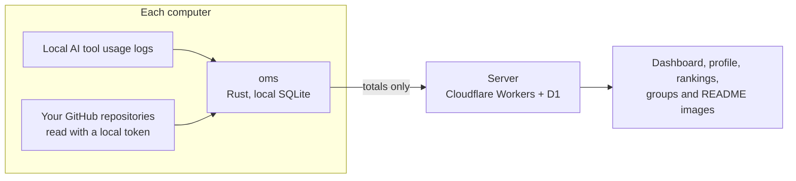

<p align="center">
  
</p>

<h1 align="center">oh-my-stats</h1>

<p align="center">
  The ultimate developer stats platform, at <a href="https://ohmystats.dev">ohmystats.dev</a>.<br>
  Your AI tokens and GitHub contributions in one place, with private work included.
</p>

<p align="center">
  <a href="https://github.com/saintlee83/oh-my-stats/actions/workflows/ci.yml"></a>
  <a href="https://github.com/saintlee83/oh-my-stats/releases/latest"></a>
  <a href="LICENSE"></a>
  
  <a href="https://ohmystats.dev"></a>
</p>

<p align="center">
  <a href="#get-started">Get started</a> ·
  <a href="#show-it-on-your-github-profile">Embed</a> ·
  <a href="#token-rankings">Rankings</a> ·
  <a href="#groups">Groups</a> ·
  <a href="#what-leaves-your-machine">Privacy</a> ·
  <a href="#run-your-own-server">Self-host</a> ·
  <a href="CONTRIBUTING.md">Contribute</a>
</p>

<p align="center">
  <a href="https://ohmystats.dev/u/saintlee83">
    
    
  </a>
</p>

Sign in with GitHub, run `oms` on each computer, and see the result on your dashboard or your GitHub profile.

- **Continuous:** `oms` records usage in the background as you work, and keeps its own record, so history survives when AI tools delete their logs. It uploads once a day, and `oms sync` uploads right away.
- **Multi-machine:** every computer signs in to the same account, and their numbers are combined correctly.
- **Your tools:** Claude Code, Codex, Gemini CLI and [fourteen more](#automatically-collected-histories) are read on their own, and any other tool can report through a [JSONL file](#add-a-provider-with-jsonl).
- **Real numbers:** GitHub's contribution API hides private work, so commits are counted by walking each repository instead.
- **Rankings and groups:** published profiles are [ranked](#token-rankings) by tokens and by estimated cost, tools and models by how many people use them, and a [group](#groups) gives a team or a circle of friends a board of its own.
- **Made for a README:** a dashboard image, eleven separate parts, a small card and a badge, in light and dark.
- **Private by default:** your profile stays hidden until you publish it, and only totals and your public GitHub profile leave your machine.

## How it works



## Get started

Install `oms` on macOS or Linux:

```sh
curl -fsSL https://ohmystats.dev/install.sh | sh
```

On Windows, in PowerShell:

```powershell
irm https://ohmystats.dev/install.ps1 | iex
```

The script downloads the [latest release](https://github.com/saintlee83/oh-my-stats/releases/latest), checks it against the release's checksums, and puts `oms` in `~/.local/bin`. On Windows it also adds that folder to your PATH. Then:

```sh
oms login             # approve a code in your browser
oms sync              # send your usage now
oms service install   # keep tracking in the background
oms publish           # optional: make your profile public
```

Repeat this on each computer. On Windows, `oms service install` adds `oms` to your startup apps, so it needs no administrator rights.

`oms` reads new log lines every 5 minutes and uploads once a day, so your numbers can be up to a day behind. A machine that was asleep or offline catches up when it comes back. Run `oms sync` to update right away, or change `uploadIntervalMinutes`.

Every file in a release has build provenance from GitHub Actions. To check a download, run `gh attestation verify <file> --repo saintlee83/oh-my-stats`.

### Include GitHub activity (optional)

`oms login` is enough to track AI tokens. To include commits, pull requests and reviews, set up GitHub CLI on **one computer**. That computer collects GitHub activity for your whole account. [Install GitHub CLI](https://cli.github.com/)

1. Run `gh auth status`. If you are signed out, run `gh auth login` and choose the same GitHub account you used for `oms login`.
2. Run `oms sync --github` to collect your GitHub stats now.
3. If the sync reports that your GitHub CLI login is missing `repo` or `read:org`, run `gh auth refresh -s repo,read:org`, approve the request, and repeat the sync. `repo` includes read and write access to public and private repositories you can access. OMS uses it to read activity. `read:org` allows reading organization and team membership. [GitHub's scope reference](https://docs.github.com/en/apps/oauth-apps/building-oauth-apps/scopes-for-oauth-apps)

If you already supply a repository access token through `OMS_GITHUB_TOKEN`, run `oms sync --github` directly. `oms` uses the credential on this computer and uploads aggregated statistics.

### Update `oms`

Run `oms update`. It asks GitHub for the newest stable release. If that is newer than yours, it downloads the release's own install script, checks it against the release's checksums, and runs it, so the new `oms` goes where the old one is. If `oms` runs in the background, it restarts on the new version. On Windows the installer stops the running `oms` to replace it, and finishes on its own. `oms update --check` only says whether a newer release exists.

`oms update` arrived in 0.3.1. On an earlier version, run the install command again, which does the same. With the install command, set `OMS_VERSION` to install a particular release, such as `v0.1.0`, or `OMS_INSTALL_DIR` to put `oms` somewhere else.

When you run `oms status`, `oms sync`, or `oms rankings` in a terminal, `oms` checks GitHub for a newer stable release up to once a day. If one is available, it says so and names the command to run: `oms update`. Set `OMS_NO_UPDATE_CHECK=1` to turn off these notices and checks.

### Build from source

Prebuilt releases cover macOS, Linux and Windows on x86_64 and ARM64. Elsewhere, or to run your own changes, build with [Rust](https://rustup.rs). On Windows, let rustup install the Visual Studio build tools when it offers.

```sh
git clone https://github.com/saintlee83/oh-my-stats
cargo install --path oh-my-stats/agent
```

To update a build of your own, pull and run `cargo install` again. `oms update` would put the prebuilt release in its place.

## Show it on your GitHub profile

Once published, add the dashboard to your GitHub profile README:

```markdown

```

Or show only the parts you want, in any order. Each part is its own image, as wide as the dashboard, so stacked parts line up:

```markdown


```

| Part | Shows |
|---|---|
| `profile` | Your name, role, company, location, status and bio, with when you started contributing, lifetime contributions, top languages, AI tokens and your rank among published profiles |
| `weekly` | Last seven days of AI tokens, change from the preceding seven days, largest provider increase and daily bars |
| `recap` | Last complete calendar month’s dated AI tokens, commits, pull requests and reviews in one README card |
| `contributions` | Contributions this year and lifetime, and commits, PRs, reviews and issues by month |
| `rhythm` | When you contribute, by weekday and hour, and by time of day |
| `languages` | Top languages by lines added, split by personal, organization, gist and other repos |
| `coauthors` | Who you co-author commits with |
| `churn` | Lines added and removed, by language |
| `tokens` | AI tokens by tool, cache hit rate, API list price, your rank among published profiles, and tokens per day for 60 days |
| `history` | Every year by month, streaks, and time to merge and review |
| `year` | One calendar year in review: AI tokens, active days, longest streak, busiest day, responses, API list price, top three models, providers by share, that year's GitHub numbers, and a calendar of every day. It is not part of the dashboard |

Your profile page lists the embed code for every part that has data. A part without data yet shows a short note instead of a broken image.

The `profile` part, which also opens the dashboard, comes from your GitHub profile. To change what it says, fill in **Profile header** on your dashboard at [ohmystats.dev/me](https://ohmystats.dev/me): a job title, a company, a status such as *Open to work* or *Hiring*, and more. Any field you leave empty keeps using your GitHub profile, which `oms` reads once a day.

The `year` part shows the current year, in your timezone, once it has usage, and the latest year with usage until then. To keep showing one year after it ends, name it. A year without usage shows the default instead:

```markdown

```

A year counts the tokens whose day is known, so it leaves out what a tool used before it kept daily figures. Models, responses and the list price come from synced logs, so they can cover less than the year's total. The price is a minimum when it starts with `≥`.

For a README with less room, choose a 495-pixel stats or ranking card, or a badge.

```markdown


```

The card shows your lifetime AI tokens, your place among published profiles, your contributions this year, your current streak and the provider you use most, from whichever of these your profile has. Add `?graph=1` for a calendar of the last 26 weeks of AI tokens.

The ranking card shows your lifetime rank among public profiles and your token totals for all time, the last 30 days and the last 7 days. Its chart shows daily usage through the current UTC date. The most recent seven days are highlighted.

The badge shows one figure. Choose it with `?metric=`:

| `metric` | Shows |
|---|---|
| `tokens` | Lifetime AI tokens. The default |
| `cost` | What they cost at API list price, a minimum when it starts with `≥` |
| `rank` | Your place among published profiles, by lifetime AI tokens |
| `contributions` | Lifetime contributions |
| `streak` | Your current contribution streak, in days |

A badge shows `n/a` until its figure exists, and `unranked` until you have a place.

Images follow the viewer's light or dark mode. By default they use GitHub's colors, so they blend into a GitHub page: its backgrounds and grays, and the greens of its contribution graph for calendars, heat maps and bars. Lines added and removed are green and red, as in a GitHub diff. In a chart of providers, Claude Code is orange, Codex is aqua and Gemini CLI is blue, the same as on the website. For [Tokyo Night](https://github.com/tokyo-night/tokyo-night-vscode-theme) colors, add `?theme=tokyo-night` to any image address. Dark mode uses Tokyo Night, and light mode uses its Day variant:

```markdown

```

The badge is the exception. Its colors are fixed, and read the same on a light page and a dark one.

## Commands

```
oms login                 Sign this machine in with GitHub
oms logout                Sign this machine out, keeping its local history
oms status                Show sign-in, totals and machines
oms rankings              Show the public, device and provider rankings by lifetime tokens
oms rankings --days 30    Compare the last 30 reporting dates
oms sync                  Read new logs and upload what changed, right now
oms sync --github         Also collect GitHub stats now
oms daemon                Keep tracking in the foreground
oms service install       Run in the background, starting at login (launchd, systemd or a Windows startup app)
oms service uninstall     Remove the background service
oms service status        Show whether the service is running
oms publish               Show your profile to everyone
oms unpublish             Make your profile private again
oms preview               Print exactly what would be uploaded, without sending anything
oms update                Install the newest release in place of this one
oms update --check        Only say whether a newer release is available
```

`oms <command> --help` lists a command's options, such as `oms login --server` for [a server of your own](#run-your-own-server).

## What leaves your machine

| Uploaded | Stays on your machine |
|---|---|
| Tokens per day and model | Prompts, responses and code |
| Lifetime totals per tool and model | Commit messages and file paths |
| Aggregated GitHub numbers, such as commits per month and lines per language | Private repository and organization names |
| This machine's name and platform, shown only to you | The token that reads your repositories |
| Your public GitHub profile: name, bio, company, location and status | |
| Your timezone, shown on your public dashboard | |

Run `oms preview` to see the next usage request, or an ordered JSON array when catching up takes multiple requests. It uses the same upload planner as `oms sync`. After everything is synced, it shows the heartbeat with empty days and totals. GitHub stats are aggregated on your machine first, so no commit-level data is sent.

The site's [privacy page](https://ohmystats.dev/privacy) covers the rest: what the server stores, the two cookies it sets, who else is involved, and how to delete your data. Its [terms](https://ohmystats.dev/terms) cover using the hosted service.

**Sign-in:** the server only ever receives a token that proves who you are. It comes from a GitHub App with no permissions, so it can't read your repositories. The server uses it once and doesn't store it, and only accepts tokens issued to its own app. It stores a hash of its own session tokens. `oms` refuses to send a GitHub token with more access than that. A machine's sign-in expires after 180 days without an upload, and signing in again replaces it.

**Publishing:** a private profile looks the same as one that doesn't exist. Publishing shows your totals per model and per day, and lists you in the public rankings. It also lists your profile in the site's `sitemap.xml`, where search engines look for pages. Where a link to your profile is shared, its preview image shows your login, lifetime AI tokens, rank, contributions this year and a calendar of the last 53 weeks of AI usage. Machine names are never public. Public pages are cached for 5 minutes, so after you unpublish, a copy can stay visible for up to that long.

**Co-authors:** AI assistants are named. Bots are too, except a custom bot in a private repo, because its name can include an organization's. People are named only if they have a GitHub account and co-authored in a public repo, counting those public commits only. Everyone else is an anonymous count. Emails are never uploaded.

**Your data:** removing a machine deletes its data and signs it out. Deleting your account removes everything on the server, after you confirm with your username. Each machine keeps its local history, so `oms login` and `oms sync` bring your usage back.

## How machines combine

Adding every number together would be wrong, because the sources have different reach:

| Source | Reach | Combined by |
|---|---|---|
| Claude Code's lifetime statistics (`stats-cache.json`) | One machine | Adding across machines |
| Codex's account total (the figure behind `/usage`) | Every device on the account | Counting once |
| Local logs, one count per model response | One machine | Adding across machines |

Usage logged after a tool's figure was last updated is added on top. Codex's split by model comes from logs, so usage outside them shows as "Model unknown" and is left out of cost. For that reason, cost is shown as a minimum, at public API list prices. The site says the same for its visitors on [How we count](https://ohmystats.dev/how-we-count).

The **Machines** table on your private dashboard and `oms status` show each device's name, token counts for the last 7 and 30 calendar days, lifetime tokens and last sync. The windows include today in your profile timezone. Machine-scoped daily figures and local records provide the device breakdown. Account-wide tokens without a matching device record appear separately in the lifetime summary. Machine names and this breakdown are visible only to the owner.

A machine's id comes from its hardware, so reinstalling doesn't register it twice. Give it a name with `oms login --name "Work laptop"` or rename it in the dashboard.

## Token rankings

| Board | Address | What it ranks |
|---|---|---|
| Profiles | `/rankings` | Published profiles by tokens, or by estimated cost with `?sort=cost`. Add `?provider=codex` to rank by one tool |
| Providers | `/rankings/providers` | Tools, by how many published profiles used each one |
| Models | `/rankings/models` | Models, by how many published profiles logged usage of each one |
| My rankings | `/me/rankings` | Your devices and providers, and your place among published profiles. Only you see it |
| Groups | `/groups` | The members of a [group](#groups), by tokens |

Every board covers all time, the last 7 or 30 days, this month or last month. The rest of this section says how each one counts.

Open **Rankings** (`/rankings`) to see published profiles by token usage, 100 to a page (`?page=2`). Each row shows the profile's name and login, the short figure, the exact one, and a bar comparing it with the first row on the page. Above the table are the number of ranked profiles and the tokens they used together. Choose a provider to rank by that tool alone, such as `/rankings?provider=codex`. The home page shows the first five profiles and the dashboard of the one ranked first, and a public profile shows its lifetime rank. **My rankings** (`/me/rankings`) shows your devices and providers, including when your profile is private. On a signed-in computer, `oms rankings` shows all three tables.

The website and CLI default to **All time**, using the lifetime token total shown by `oms status`. Choose **Last 7 days** or **Last 30 days** (CLI `--days 7` or `--days 30`) to rank dated usage through today's UTC date. The website also has **This month**, from the first of the month through today, and **Last month**, the whole calendar month before (`?days=month` and `?days=last-month`), both in UTC. API clients can request lifetime totals with `GET /v1/rankings?days=all`. Omitting `days` on the v1 API keeps its seven-day default, and the API takes all time, 7 days and 30 days only.

Rankings include input, output, cache reads and cache writes. Profiles with positive usage qualify, and equal totals share a rank (1, 1, 3). Setting a profile to private removes it from the public rankings immediately. The home page's preview and the rank on profile pages are cached like other public pages, so they can lag by up to five minutes. Account-wide usage counts once in user and provider scores. A device receives credit for usage attributable to that device.

**By estimated cost** (`/rankings?sort=cost`) ranks the same profiles by what their logged responses in the period would cost at public API list prices, and shows the tokens of those responses beside the cost. It is an estimate, not what anyone paid, because subscription plans pay differently. It prices only usage found in logs, so it is lower than the cost on a profile's own page when a tool reports more usage than its logs hold. A model without a list price adds tokens but no cost, a profile with no priced usage is not ranked, and equal costs share a rank.

Two more boards sit beside the profiles and take the same periods. **Providers** (`/rankings/providers`) ranks the tools `oms` reads on its own by how many published profiles used each one in the period, then by tokens. It shows active profiles, adoption (their share of all ranked profiles), tokens, and the change in active profiles from the period before: as many days, or the whole month before. The change reads `+3`, `−2` or `new`, with a percentage only when the period before had at least 25 active profiles. All time has no change. **Models** (`/rankings/models`) ranks up to 100 models by how many published profiles logged usage of each one. It shows the provider most of a model's tokens came through, active profiles, adoption among the profiles with logged usage, tokens, cost at list prices and the same change. Provider IDs and model names are chosen by whoever uploads them, so a provider ID `oms` does not know is never listed, a model is listed only when it has a public list price, and a dated model name counts as the model it is priced as. Every board counts published profiles only.

## Groups

A group is a board for a team or a circle of friends: its members, ranked by tokens with the same score the public rankings use. Open `/groups` to start one, see the ones you are in, or look through the public ones. A board covers all time, the last 7 or 30 days, this month or last month.

- **Private groups** are shown to their members only. To anyone else, signed in or not, a private group looks the same as one that doesn't exist. People join with the owner's invite link. The owner can make a new link at any time, and the old one stops working.
- **Public groups** can be opened by anyone and joined by any signed-in account. People who are not members see only the members whose profiles are public, and how many are not shown. Members see every member.

**Joining shows your token totals to the group's members, even while your profile is private.** That means your GitHub username and your token total for each period the board covers. It doesn't show models, a day-by-day history or machine names. A member with a private profile is named on the board without a link to a profile. When you leave, your totals stop showing there at once.

The owner can rename the group, change who can see it, remove a member, and delete the group after typing its name. A private group can be made public only while every other member's profile is public, because a public group lets anyone join and see its members' totals. The owner can't leave while others remain. Deleting your account removes your memberships and the groups you own.

An account can own 5 groups and be in 20, and a group holds 200 members. A group's address is its name followed by a few random characters, so starting a group never tells you whether another one already has that name. Group pages are not cached, so a change shows on the next visit.

## Provider activity

On your personal dashboard (`/me`), **Overview** charts daily tokens over the last 7, 30 or 60 days in your profile timezone, each day's bar split by provider or by model, and lists the period's share of tokens by provider and by model. Split by model, a bar keeps a paler part for the tokens no logged response names a model for. Hover or tap the chart to see a day's total, providers and models, or focus it and use the arrow keys. **Activity** holds the calendar and detailed usage tables. **Machines** shows your devices, and **Settings** controls your profile and its visibility.

The dashboard and published profiles include an AI usage calendar of the last 53 weeks, which can switch to each calendar year with usage, up to the newest four. Point at a day or tap it to see its exact token total with its providers and models, or focus the calendar and move through the days with the arrow keys. **Usage by period** shows tokens, active days, the most used provider and the busiest day for your lifetime, the last 30 and 7 days, this month and last month, and how each period's tokens split by provider and by model. A provider or a model keeps one color in every chart and every period of a page. A profile has eight such colors, and names past the eighth are shown together in gray. Only logged responses name a model, so a period's models can cover fewer tokens than its total, and the page says how many. Lifetime includes tokens from before a tool's daily records begin. They have no date, so the calendar and the other periods leave them out. **Token mix** splits tokens into input, output, cache reads and cache writes, and covers only tokens with a known breakdown. The provider share table compares the previous calendar month with the current month to date in the profile timezone. The weekly card also appears in `oms status`. A missing comparison period has no percentage change.

Signed-in users can compare lifetime and seven-day public positions on **My rankings**, including ranks below the top 100. Each rank shows the number of public profiles with positive usage in that period. The private device table shows account usage with no matching device for each window.

Your dashboard, public token card and `oms status` compare the most recent seven calendar days (including today) with the preceding seven. Each provider also shows active days, logged responses and average tokens per logged response over 30 days. Weekly volumes use the same daily totals as the chart. Response averages use only tokens and response counts from local logs. The chart groups smaller providers under “Others” when more than four are present. The table lists every provider.

Gemini CLI sessions under `~/.gemini/tmp/<project>/chats/session-*.jsonl` and older `session-*.json` files are discovered automatically. Cached input is counted once, tool-prompt tokens contribute to input, and thinking tokens contribute to output. Repeated message records count once by message ID. Gemini and imported usage cover the machines running `oms`. [Gemini CLI recording format](https://github.com/google-gemini/gemini-cli/blob/main/packages/core/src/services/chatRecordingTypes.ts)

### Automatically collected histories

Besides Claude Code, Claude Desktop agent sessions, Codex and Gemini CLI, `oms` discovers these histories on the machine it runs on. An existing history is included on the first scan. Run `oms preview` to inspect its daily totals.

| Provider ID | Default local source | Usage record |
|---|---|---|
| `amp` | `~/.local/share/amp/threads/T-*.json` | Assistant messages with token counts in locally stored threads. Older messages use the most recent prompt time or thread creation time. |
| `cline-cli` | `~/.cline/data/sessions/**/*.messages.json` | Completed assistant turns with metrics in version 1 session snapshots. |
| `copilot-cli` | `~/.copilot/session-state/**/events.jsonl` | Per-request `session.usage_record` entries. Shutdown totals and premium requests are skipped. |
| `goose` | `~/.local/share/goose/sessions/sessions.db` | Model calls in the `usage_ledger` table. Session totals from before Goose kept the ledger are skipped. |
| `hermes-agent` | `~/.hermes/state.db` and `~/.hermes/profiles/*/state.db` | Token counters and API call counts in `session_model_usage`. |
| `kilo-code` | `~/.local/share/kilo/kilo.db`, and `kilocode.kilo-code/tasks/*/ui_messages.json` in each editor's extension storage | Finished model steps of assistant messages from the Kilo CLI and the extension since version 7, and API requests in the earlier extension's task logs. |
| `kimi-cli` | `~/.kimi-code/sessions/**/agents/*/wire.jsonl` | Durable `usage.record` events from Kimi Code CLI, including subagents. |
| `oh-my-pi` | `~/.omp/agent/sessions/**/*.jsonl` | Assistant message entries and `model_usage` entries, including subagent sessions. |
| `openclaw` | `~/.openclaw/agents/*/sessions/` and `~/.openclaw/agents/*/agent/openclaw-agent.sqlite` | Assistant messages with token counts in session transcripts and in each agent's database, including the transcripts kept of deleted and reset sessions. |
| `opencode` | `~/.local/share/opencode/opencode.db` | Assistant usage in v1 and v2 message tables and older `storage/message/**/*.json` files. |
| `pi` | `~/.pi/agent/sessions/**/*.jsonl` | Assistant message entries with model usage. |
| `qwen-code` | `~/.qwen/projects/*/chats/` | Current and archived assistant JSONL records with token breakdowns. |
| `roo-code` | `rooveterinaryinc.roo-cline/tasks/*/ui_messages.json` in each editor's extension storage | API requests with token counts in each task's message log. |
| `zed` | `threads/threads.db` in Zed's data folder | The running total of tokens that each agent thread keeps. |

OpenCode, Amp, Goose, Kilo and Oh My Pi follow `XDG_DATA_HOME`. The readers also respect `PI_CODING_AGENT_DIR`, `QWEN_RUNTIME_DIR`, `QWEN_HOME`, `COPILOT_HOME`, `KIMI_CODE_HOME`, `HERMES_HOME`, `GOOSE_PATH_ROOT`, `OPENCLAW_STATE_DIR` and Cline's session/data directory overrides. On Windows, Goose keeps its database in `%APPDATA%\Block\goose\data\sessions`. SQLite sources are opened read-only, including committed changes in the write-ahead log. If a history is mirrored across computers or already covered by a custom exporter, set `skipNativeLogs` on the extra machine before its first scan.

Hermes keeps cumulative counters per session and model. Each scan credits newly observed tokens and API calls to the latest recorded call's day. A first scan or a gap between scans can place several days of Hermes usage on one day. Zed is counted the same way, with the differences described below. In Copilot sessions without per-request token records and Amp installations without local thread snapshots, local history may be incomplete. Cursor CLI's ordinary saved chat transcripts do not provide a verified token breakdown for this reader. A custom exporter can supply measured usage through the format below.

Roo Code, and the Kilo Code extension before version 7, keep a message log per task in the editor's extension storage. That is `~/Library/Application Support/<editor>/User/globalStorage` on macOS, `~/.config/<editor>/User/globalStorage` on Linux, `%APPDATA%\<editor>\User\globalStorage` on Windows, and `~/.vscode-server/data/User/globalStorage` on a remote host. Every editor built on VS Code is checked, such as Cursor, Windsurf and VSCodium. Kilo Code's earlier JetBrains plugin and CLI are read from `~/.kilocode`. A custom storage path set in the extension isn't followed. These logs don't name the model, so their usage shows as "Model unknown" and has no price. Roo Code 3.29.5 and Kilo Code 4.119.0 began storing the whole prompt size, cached tokens included. Earlier requests stored what the provider reported, so cached tokens are taken out of the prompt size whenever they fit inside it. Cached input is never counted twice, and some earlier requests can count less new input than they used. A request removed from a task before a scan isn't counted.

Kilo counts a model step once when a fork copies it into another session. A session imported from Kilo's cloud counts on the machine that imported it. `KILO_DB` and databases of development builds aren't followed.

Goose added its ledger of model calls in a release between 1.40 and 1.45. Usage from before that exists only as session totals, without dates or models, and isn't counted. Sessions that run Claude Code, Codex, Gemini CLI, Cursor Agent or an ACP agent through Goose are left out, because those tools keep their own records. This goes by the provider a session used last.

Oh My Pi sessions imported from Claude Code or Codex count from the import onward, because the earlier usage is in those tools' own records. Profiles under `~/.omp/profiles` are read. Oh My Pi's `PI_CODING_AGENT_DIR` and `PI_CONFIG_DIR` overrides share their names with Pi's and aren't followed. Sessions archived by `omp gc` aren't read from the archive.

OpenClaw keeps a session in a file, in its agent's database, or in both, and a fork starts as a copy of the session it left. An entry counts once, wherever it is found. Named profiles under `~/.openclaw-<profile>` and the earlier `~/.clawdbot` are read. A turn an agent runs through Codex is counted as Codex usage, from the log Codex keeps in that agent's `codex-home` folder, because the transcript holds only the turn's last response. A session OpenClaw has moved to cold storage isn't read from there, so a first scan misses it.

Zed keeps one running total per agent thread and no record of each request. Each scan credits the tokens a thread has gained since the last scan to the day the thread last changed, under the model the thread uses then. A first scan places a thread's whole history on that one day. Responses are counted from the agent's replies in the thread, so a thread that is cut back and continued can show fewer responses than it made. Threads count whichever model provider they use, Zed's own or your API key. External agents that run inside Zed, such as Claude Code, keep their own records. Zed's data folder is `~/Library/Application Support/Zed` on macOS, `~/.local/share/zed` on Linux, following `XDG_DATA_HOME`, and `%LOCALAPPDATA%\Zed` on Windows.

The readers use the CLI's on-disk records independently of the Alkahest runner. [Cline session contract](https://github.com/cline/cline/blob/main/sdk/packages/core/docs/messages-contract-v1.md) · [OpenCode token schema](https://github.com/anomalyco/opencode/blob/dev/packages/schema/src/token-usage.ts) · [Qwen recorder](https://github.com/QwenLM/qwen-code/blob/main/packages/core/src/services/chatRecordingService.ts) · [Kimi wire fixture](https://github.com/MoonshotAI/kimi-code/blob/main/apps/vis/server/test/fixtures/sessions/sample-main/agents/main/wire.jsonl) · [Roo Code token totals](https://github.com/RooCodeInc/Roo-Code/blob/main/src/shared/cost.ts) · [Kilo usage query](https://github.com/Kilo-Org/kilocode/blob/main/packages/opencode/src/kilocode/agent-usage/index.ts) · [Goose session store](https://github.com/aaif-goose/goose/blob/main/crates/goose/src/session/session_manager.rs) · [Oh My Pi session format](https://github.com/can1357/oh-my-pi/blob/main/docs/session.md) · [OpenClaw agent database](https://github.com/openclaw/openclaw/blob/main/src/state/openclaw-agent-schema.sql) · [OpenClaw transcript files](https://github.com/openclaw/openclaw/blob/main/src/config/sessions/transcript-file-names.ts) · [Zed thread store](https://github.com/zed-industries/zed/blob/main/crates/agent/src/db.rs)

### Add a provider with JSONL

Have your tool or exporter append one JSON object per completed response to a newline-terminated `.jsonl` file anywhere under `~/.oh-my-stats/imports/` (or `$OMS_HOME/imports/`). Create the directory on the machine that produced the usage. For example, this line records 175 tokens:

```json
{"provider":"local-ai","id":"response-42","timestamp":"2026-11-09T10:15:00Z","model":"my-model","input":100,"output":50,"cacheRead":25,"cacheWrite":0}
```

- Use a stable response ID unique within the provider. Replaying or moving the file on the same machine preserves that identity. Export each response on one machine.
- Use a provider ID matching `[a-z][a-z0-9_-]{0,31}`. The IDs `claude`, `codex`, `gemini` and `constructor` are reserved. Use a model identifier up to 120 ASCII characters, starting with a letter or digit and using letters, digits or `._:@+-/`.
- Supply an RFC 3339 timestamp with an offset and nonnegative integer token counts. Input excludes cache reads and writes. Output includes reasoning. Both cache fields default to zero.
- Run `oms preview` to inspect the daily totals and `oms sync` to upload them. Only the provider, model and daily counts from the export reach the server. Choose public-facing provider and model names if you publish your profile. The bundled price lookup covers Claude, OpenAI and Gemini model families. Other models still contribute to usage and show an unavailable price.

## Run your own server

The server is a single Cloudflare Worker with a D1 database. Its pages are React, served by [vinext](https://github.com/cloudflare/vinext).

1. [Create a GitHub App](https://github.com/settings/apps/new) with no permissions, so its tokens can only identify a user. Set the callback URL to `https://your-server/auth/callback`, **enable device flow**, turn off the webhook, and allow installation on any account.
2. Create the database. In `wrangler.jsonc`, put in its id, your domain under `routes`, and your app's `GITHUB_CLIENT_ID` under `vars`.
   ```sh
   pnpm install
   npx wrangler d1 create oh-my-stats
   npx wrangler d1 migrations apply DB --remote
   ```
3. Add the client secret and deploy.
   ```sh
   npx wrangler secret put GITHUB_CLIENT_SECRET
   pnpm run deploy
   ```

Then sign each computer in to it with `oms login --server https://your-server`.

To update a server, apply any new migrations before deploying: `npx wrangler d1 migrations apply DB --remote`, then `pnpm run deploy`. A page that needs a table the database doesn't have yet fails until they are applied.

## Known limits

- **Claude Code has no account-wide figure** for individual plans in its docs, so a machine without `oms` isn't counted. Its statistics file isn't a public format, so a future version could change it. If it does, `oms` keeps the last known total and uses logs.
- **Codex's account total** assumes all your machines use one Codex account.
- **AI tools:** `oms` reads Claude Code, Claude Desktop agent sessions, Codex, Gemini CLI and the twelve histories listed above. Other providers can export usage events in JSONL.
- **Default branches only.** Commits still on other branches aren't walked, which matches how GitHub counts contributions. Your GitHub graph can show more than can be itemized, for example work in repositories that were later deleted.
- **Churn reads the first 300 files of a commit**, and treats a commit over 20,000 lines as a bulk import. Change this with `maxCommitLines` in `~/.oh-my-stats/config.json`.
- **On Windows**, Windows can't replace a running program. The install script and `oms update` stop `oms` and start it again for you, but with `cargo install`, run `oms service uninstall` first and `oms service install` afterwards. The folder where `oms` keeps its state is kept private by your user folder's permissions, rather than by its own.
- **Releases aren't signed by Apple or Microsoft.** The install scripts aren't affected, but a file downloaded with a browser can be blocked by Gatekeeper on macOS or flagged by SmartScreen on Windows.
- **Uploads are capped** at 20,000 changed rows per account per day. Anything over that goes through the next day. An account can have 50 machines.
- **Rate limits are approximate.** They use Cloudflare's rate limiting, which counts per location and can briefly let requests through above the limit.

## Configuration

`~/.oh-my-stats/config.json`, or `%USERPROFILE%\.oh-my-stats\config.json` on Windows, in addition to what `oms login` writes:

| Key | Default | Meaning |
|---|---|---|
| `timezone` | System | IANA zone for days and the rhythm chart |
| `uploadIntervalMinutes` | `1440` | How often to upload. Usage is recorded locally all the time. The minimum is 5 |
| `machineName` | Hostname | The name reported for a new machine. Rename it on your dashboard afterwards |
| `skipNativeLogs` | `[]` | Provider IDs whose local logs this machine should skip, such as `["pi"]`. Export files and tool-reported lifetime statistics are collected separately. |
| `excludeLanguages` | `[]` | For example `["Jupyter Notebook"]` |
| `namedCoauthors` | `[]` | Logins to name on the co-author card, including private commits. Use this for people who've agreed |
| `agentCoauthors` | `[]` | Your own AI agent accounts: named, and counted as AI |
| `maxCommitLines` | `20000` | A commit changing more lines is treated as a bulk import |
| `maxFileLines` | `5000` | A bigger single-file diff is treated as generated |
| `maxRequestsPerRun` | `4000` | GitHub API budget per collection |

Environment variables:

| Variable | Meaning |
|---|---|
| `OMS_HOME` | Where `oms` keeps its state, instead of `~/.oh-my-stats` |
| `OMS_SERVER` | The server `oms login` signs in to, when `--server` isn't given |
| `OMS_TIMEZONE` | An IANA zone, used instead of `timezone` above |
| `OMS_GITHUB_TOKEN` | A token that can read your repositories, for collecting GitHub activity without GitHub CLI. It is used on this machine and never uploaded |
| `OMS_NO_UPDATE_CHECK` | Set it to turn off the daily check for a newer release, and its notice |
| `OMS_VERSION`, `OMS_INSTALL_DIR` | Read by the install scripts: a release to install instead of the latest, and where to put `oms` instead of `~/.local/bin` |
| `OMS_DOWNLOAD_URL` | A copy of a release's files to download from instead of GitHub. The install scripts and `oms update` read it |

## Development

Bug reports, new tool readers and fixes are welcome. To run everything on your own computer:

```sh
pnpm install
cp .dev.vars.example .dev.vars
pnpm db:local && pnpm dev            # server on localhost:8787
pnpm test && pnpm typecheck

cd agent && cargo test
export OMS_HOME=~/.oh-my-stats-dev   # keeps this apart from your real sign-in
cargo run -- login --server http://localhost:8787 --gh
cargo run -- sync
```

`oms login` replaces the sign-in kept in `~/.oh-my-stats`, so `OMS_HOME` gives the development build a folder of its own. With `ALLOW_ANY_GITHUB_TOKEN=true` in `.dev.vars`, a local server accepts your GitHub CLI login, so you don't need a GitHub App to develop. The server ignores this setting anywhere but this computer, and `oms` only uses `--gh` with a server on this computer.

[CONTRIBUTING.md](CONTRIBUTING.md) has the rest: how the code is laid out, what a change needs before it is merged, how to add an AI tool, a page, a README image or a table, and how a release is made.

**The one rule that matters:** repository, organization and file names exist only inside `agent/src/github/collect.rs`. `Snapshot` has none, so nothing downstream can leak them. Its one piece of free text is your public GitHub profile, which anyone can already see.

## License

[MIT](LICENSE)
