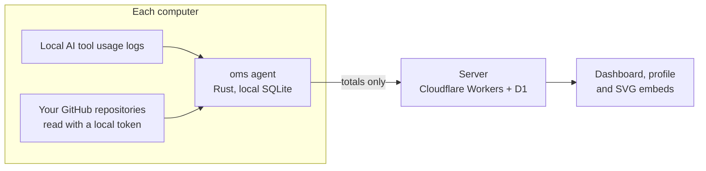

<p align="center">
  
</p>

<h1 align="center">oh-my-stats</h1>

<p align="center">
  The ultimate developer stats platform, at <a href="https://ohmystats.dev">ohmystats.dev</a>.<br>
  Your AI tokens and GitHub contributions in one place, with private work included.
</p>

<p align="center">
  <a href="https://github.com/saintlee83/oh-my-stats/actions/workflows/ci.yml"></a>
  <a href="LICENSE"></a>
  
  <a href="https://ohmystats.dev"></a>
</p>

<p align="center">
  <a href="#get-started">Get started</a> ·
  <a href="#show-it-on-your-github-profile">Embed</a> ·
  <a href="#what-leaves-your-machine">Privacy</a> ·
  <a href="#run-your-own-server">Self-host</a>
</p>

<p align="center">
  <a href="https://ohmystats.dev/u/saintlee83">
    
    
  </a>
</p>

Sign in with GitHub, run a small agent on each computer, and see the result on your dashboard or your GitHub profile.

- **Continuous:** a background agent records usage as you work, and keeps its own record, so history survives when AI tools delete their logs. It uploads once a day, and `oms sync` uploads right away.
- **Multi-machine:** every computer signs in to the same account, and their numbers are combined correctly.
- **Real numbers:** GitHub's contribution API hides private work, so commits are counted by walking each repository instead.
- **Private by default:** your profile stays hidden until you publish it, and only totals and your public GitHub profile leave your machine.

## How it works



## Get started

Install the agent on macOS or Linux:

```sh
curl -fsSL https://ohmystats.dev/install.sh | sh
```

On Windows, in PowerShell:

```powershell
irm https://ohmystats.dev/install.ps1 | iex
```

The script downloads the [latest release](https://github.com/saintlee83/oh-my-stats/releases/latest), checks it against the release's checksums, and puts `oms` in `~/.local/bin`. On Windows it also adds that folder to your PATH. Then:

```sh
oms login             # approve a code in your browser
oms sync              # send your usage now
oms service install   # keep tracking in the background
oms publish           # optional: make your profile public
```

Repeat this on each computer. On Windows, `oms service install` adds the agent to your startup apps, so it needs no administrator rights.

To update, run the install command again. If the agent runs in the background, it restarts on the new version. Set `OMS_VERSION` to install a particular release, such as `v0.1.0`, or `OMS_INSTALL_DIR` to put `oms` somewhere else.

When you run `oms status`, `oms sync`, or `oms rankings` in a terminal, the agent checks GitHub for a newer stable release up to once a day. If one is available, it shows the update command for the current installation. Set `OMS_NO_UPDATE_CHECK=1` to turn off these notices and checks.

Every file in a release has build provenance from GitHub Actions. To check a download, run `gh attestation verify <file> --repo saintlee83/oh-my-stats`.

### Build from source

Prebuilt agents cover macOS, Linux and Windows on x86_64 and ARM64. Elsewhere, or to run your own changes, build with [Rust](https://rustup.rs). On Windows, let rustup install the Visual Studio build tools when it offers.

```sh
git clone https://github.com/saintlee83/oh-my-stats
cargo install --path oh-my-stats/agent
```

The agent reads new log lines every 5 minutes and uploads once a day, so your numbers can be up to a day behind. A machine that was asleep or offline catches up when it comes back. Run `oms sync` to update right away, or change `uploadIntervalMinutes`.

GitHub stats need read access to your repositories, and that access stays on your machine. The agent uses your [GitHub CLI](https://cli.github.com) login if you have one, after `gh auth refresh -s repo,read:org`. Otherwise, set `OMS_GITHUB_TOKEN` to a token with the `repo` and `read:org` scopes. Only one computer needs this: GitHub stats are collected once per account, by a computer that has access.

## Show it on your GitHub profile

Once published, add the dashboard to your GitHub profile README:

```markdown

```

Or show only the parts you want, in any order. Each part is its own image, as wide as the dashboard, so stacked parts line up:

```markdown


```

| Part | Shows |
|---|---|
| `profile` | Your name, role, company, location, status and bio, with when you started contributing, lifetime contributions, top languages and AI tokens |
| `weekly` | Last seven days of AI tokens, change from the preceding seven days, largest provider increase and daily bars |
| `recap` | Last complete calendar month’s dated AI tokens, commits, pull requests and reviews in one README card |
| `contributions` | Contributions this year and lifetime, and commits, PRs, reviews and issues by month |
| `rhythm` | When you contribute, by weekday and hour, and by time of day |
| `languages` | Top languages by lines added, split by personal, organization, gist and other repos |
| `coauthors` | Who you co-author commits with |
| `churn` | Lines added and removed, by language |
| `tokens` | AI tokens by tool, cache hit rate, API list price, and tokens per day for 60 days |
| `history` | Every year by month, streaks, and time to merge and review |

Your profile page lists the embed code for every part that has data. A part without data yet shows a short note instead of a broken image.

The `profile` part, which also opens the dashboard, comes from your GitHub profile. To change what it says, fill in **Profile header** on your dashboard at [ohmystats.dev/me](https://ohmystats.dev/me): a job title, a company, a status such as *Open to work* or *Hiring*, and more. Any field you leave empty keeps using your GitHub profile, which the agent reads once a day.

Images follow the viewer's light or dark mode. By default they use GitHub's colors, so they blend into a GitHub page. For [Tokyo Night](https://github.com/tokyo-night/tokyo-night-vscode-theme) colors, add `?theme=tokyo-night` to any image address. Dark mode uses Tokyo Night, and light mode uses its Day variant:

```markdown

```

## Commands

```
oms login                 Sign this machine in with GitHub
oms logout                Sign this machine out, keeping its local history
oms status                Show sign-in, totals and machines
oms rankings               Show the public, device and provider rankings by lifetime tokens
oms rankings --days 30     Compare the last 30 reporting dates
oms sync                  Read new logs and upload what changed, right now
oms sync --github         Also collect GitHub stats now
oms daemon                Keep tracking in the foreground
oms service install       Run in the background, starting at login (launchd, systemd or a Windows startup app)
oms service uninstall     Remove the background service
oms service status        Show whether the service is running
oms publish               Show your profile to everyone
oms unpublish             Make your profile private again
oms preview               Print exactly what would be uploaded, without sending anything
```

## What leaves your machine

| Uploaded | Stays on your machine |
|---|---|
| Tokens per day and model | Prompts, responses and code |
| Lifetime totals per tool and model | Commit messages and file paths |
| Aggregated GitHub numbers, such as commits per month and lines per language | Private repository and organization names |
| This machine's name and platform, shown only to you | The token that reads your repositories |
| Your public GitHub profile: name, bio, company, location and status | |
| Your timezone, shown on your public dashboard | |

Run `oms preview` to see the next usage request, or an ordered JSON array when catching up takes multiple requests. It uses the same upload planner as `oms sync`. After everything is synced, it shows the heartbeat with empty days and totals. GitHub stats are aggregated on your machine first, so no commit-level data is sent.

**Sign-in:** the server only ever receives a token that proves who you are. It comes from a GitHub App with no permissions, so it can't read your repositories. The server uses it once and doesn't store it, and only accepts tokens issued to its own app. It stores a hash of its own session tokens. The agent refuses to send a GitHub token with more access than that. A machine's sign-in expires after 180 days without an upload, and signing in again replaces it.

**Publishing:** a private profile looks the same as one that doesn't exist. Publishing shows your totals per model and per day, and lists you in the public rankings. Machine names are never public. Public pages are cached for 5 minutes, so after you unpublish, a copy can stay visible for up to that long.

**Co-authors:** AI assistants are named. Bots are too, except a custom bot in a private repo, because its name can include an organization's. People are named only if they have a GitHub account and co-authored in a public repo, counting those public commits only. Everyone else is an anonymous count. Emails are never uploaded.

**Your data:** removing a machine deletes its data and signs it out. Deleting your account removes everything on the server, after you confirm with your username. Each machine keeps its local history, so `oms login` and `oms sync` bring your usage back.

## How machines combine

Adding every number together would be wrong, because the sources have different reach:

| Source | Reach | Combined by |
|---|---|---|
| Claude Code's lifetime statistics (`stats-cache.json`) | One machine | Adding across machines |
| Codex's account total (the figure behind `/usage`) | Every device on the account | Counting once |
| Local logs, one count per model response | One machine | Adding across machines |

Usage logged after a tool's figure was last updated is added on top. Codex's split by model comes from logs, so usage outside them shows as "Model unknown" and is left out of cost. For that reason, cost is shown as a minimum, at public API list prices.

The **Machines** table on your private dashboard and `oms status` show each device's name, token counts for the last 7 and 30 calendar days, lifetime tokens and last sync. The windows include today in your profile timezone. Machine-scoped daily figures and local records provide the device breakdown. Account-wide tokens without a matching device record appear separately in the lifetime summary. Machine names and this breakdown are visible only to the owner.

A machine's id comes from its hardware, so reinstalling doesn't register it twice. Give it a name with `oms login --name "Work laptop"` or rename it in the dashboard.

## Token rankings

Open **Rankings** (`/rankings`) to see the top 100 published profiles by token usage. Each row shows the short figure, the exact one, and a bar comparing it with the leader. Choose a provider to rank by that tool alone, such as `/rankings?provider=codex`. The home page shows the first five profiles and the dashboard of the one ranked first, and a public profile shows its lifetime rank. **My rankings** (`/me/rankings`) shows your devices and providers, including when your profile is private. A signed-in agent can show all three tables with `oms rankings`.

The website and CLI default to **All time**, using the lifetime token total shown by `oms status`. Choose **Last 7 days** or **Last 30 days** (CLI `--days 7` or `--days 30`) to rank dated usage through today's UTC date. API clients can request lifetime totals with `GET /v1/rankings?days=all`. Omitting `days` on the v1 API keeps its seven-day default.

Rankings include input, output, cache reads and cache writes. Profiles with positive usage qualify, and equal totals share a rank (1, 1, 3). Setting a profile to private removes it from the public rankings immediately. The home page's preview and the rank on profile pages are cached like other public pages, so they can lag by up to five minutes. Account-wide usage counts once in user and provider scores. A device receives credit for usage attributable to that device.

## Provider activity

The dashboard and published profiles include an AI usage calendar of the last 53 weeks, which can switch to each calendar year with usage, up to the newest four. In the last 53 weeks, select a day to see its exact token total and provider breakdown. **Usage by period** shows tokens, active days, the most used provider and the busiest day for your lifetime, the last 30 and 7 days, this month and last month. Lifetime includes tokens from before a tool's daily records begin. They have no date, so the calendar and the other periods leave them out. **Token mix** splits tokens into input, output, cache reads and cache writes, and covers only tokens with a known breakdown. The provider share table compares the previous calendar month with the current month to date in the profile timezone. The weekly card also appears in `oms status`. A missing comparison period has no percentage change.

Signed-in users can compare lifetime and seven-day public positions on **My rankings**, including ranks below the top 100. Each rank shows the number of public profiles with positive usage in that period. The private device table shows account usage with no matching device for each window.

Your dashboard, public token card and `oms status` compare the most recent seven calendar days (including today) with the preceding seven. Each provider also shows active days, logged responses and average tokens per logged response over 30 days. Weekly volumes use the same daily totals as the chart. Response averages use only tokens and response counts from local logs. The chart groups smaller providers under “Others” when more than four are present. The table lists every provider.

Gemini CLI sessions under `~/.gemini/tmp/<project>/chats/session-*.jsonl` and older `session-*.json` files are discovered automatically. Cached input is counted once, tool-prompt tokens contribute to input, and thinking tokens contribute to output. Repeated message records count once by message ID. Gemini and imported usage cover the machines running the agent. [Gemini CLI recording format](https://github.com/google-gemini/gemini-cli/blob/main/packages/core/src/services/chatRecordingTypes.ts)

### Automatically collected CLI histories

The agent discovers these histories on the machine where you run `oms`. An existing history is included on the first scan. Run `oms preview` to inspect its daily totals.

| Provider ID | Default local source | Usage record |
|---|---|---|
| `amp` | `~/.local/share/amp/threads/T-*.json` | Assistant messages with token counts in locally stored threads. Older messages use the most recent prompt time or thread creation time. |
| `cline-cli` | `~/.cline/data/sessions/**/*.messages.json` | Completed assistant turns with metrics in version 1 session snapshots. |
| `copilot-cli` | `~/.copilot/session-state/**/events.jsonl` | Per-request `session.usage_record` entries. Shutdown totals and premium requests are skipped. |
| `hermes-agent` | `~/.hermes/state.db` and `~/.hermes/profiles/*/state.db` | Token counters and API call counts in `session_model_usage`. |
| `kimi-cli` | `~/.kimi-code/sessions/**/agents/*/wire.jsonl` | Durable `usage.record` events from Kimi Code CLI, including subagents. |
| `opencode` | `~/.local/share/opencode/opencode.db` | Assistant usage in v1 and v2 message tables and older `storage/message/**/*.json` files. |
| `pi` | `~/.pi/agent/sessions/**/*.jsonl` | Assistant message entries with model usage. |
| `qwen-code` | `~/.qwen/projects/*/chats/` | Current and archived assistant JSONL records with token breakdowns. |

OpenCode and Amp follow `XDG_DATA_HOME`. The readers also respect `PI_CODING_AGENT_DIR`, `QWEN_RUNTIME_DIR`, `QWEN_HOME`, `COPILOT_HOME`, `KIMI_CODE_HOME`, `HERMES_HOME` and Cline's session/data directory overrides. SQLite sources are opened read-only, including committed changes in the write-ahead log. If a history is mirrored across computers or already covered by a custom exporter, set `skipNativeLogs` on the extra machine before its first scan.

Hermes keeps cumulative counters per session and model. Each scan credits newly observed tokens and API calls to the latest recorded call's day. A first scan or a gap between scans can place several days of Hermes usage on one day. In Copilot sessions without per-request token records and Amp installations without local thread snapshots, local history may be incomplete. Cursor CLI's ordinary saved chat transcripts do not provide a verified token breakdown for this reader. A custom exporter can supply measured usage through the format below.

The readers use the CLI's on-disk records independently of the Alkahest runner. [Cline session contract](https://github.com/cline/cline/blob/main/sdk/packages/core/docs/messages-contract-v1.md) · [OpenCode token schema](https://github.com/anomalyco/opencode/blob/dev/packages/schema/src/token-usage.ts) · [Qwen recorder](https://github.com/QwenLM/qwen-code/blob/main/packages/core/src/services/chatRecordingService.ts) · [Kimi wire fixture](https://github.com/MoonshotAI/kimi-code/blob/main/apps/vis/server/test/fixtures/sessions/sample-main/agents/main/wire.jsonl)

### Add a provider with JSONL

Have your tool or exporter append one JSON object per completed response to a newline-terminated `.jsonl` file anywhere under `~/.oh-my-stats/imports/` (or `$OMS_HOME/imports/`). Create the directory on the machine that produced the usage. For example, this line records 175 tokens:

```json
{"provider":"local-ai","id":"response-42","timestamp":"2026-11-09T10:15:00Z","model":"my-model","input":100,"output":50,"cacheRead":25,"cacheWrite":0}
```

- Use a stable response ID unique within the provider. Replaying or moving the file on the same machine preserves that identity. Export each response on one machine.
- Use a provider ID matching `[a-z][a-z0-9_-]{0,31}`. The IDs `claude`, `codex`, `gemini` and `constructor` are reserved. Use a model identifier up to 120 ASCII characters, starting with a letter or digit and using letters, digits or `._:@+-/`.
- Supply an RFC 3339 timestamp with an offset and nonnegative integer token counts. Input excludes cache reads and writes. Output includes reasoning. Both cache fields default to zero.
- Run `oms preview` to inspect the daily totals and `oms sync` to upload them. Only the provider, model and daily counts from the export reach the server. Choose public-facing provider and model names if you publish your profile. The bundled price lookup covers Claude, OpenAI and Gemini model families. Other models still contribute to usage and show an unavailable price.

## Run your own server

The server is a single Cloudflare Worker with a D1 database, and has no runtime dependencies.

1. [Create a GitHub App](https://github.com/settings/apps/new) with no permissions, so its tokens can only identify a user. Set the callback URL to `https://your-server/auth/callback`, **enable device flow**, turn off the webhook, and allow installation on any account.
2. Create the database. In `wrangler.jsonc`, put in its id, your domain under `routes`, and your app's `GITHUB_CLIENT_ID` under `vars`.
   ```sh
   pnpm install
   npx wrangler d1 create oh-my-stats
   npx wrangler d1 migrations apply DB --remote
   ```
3. Add the client secret and deploy.
   ```sh
   npx wrangler secret put GITHUB_CLIENT_SECRET
   npx wrangler deploy
   ```

Then point agents at it with `oms login --server https://your-server`.

## Known limits

- **Claude Code has no account-wide figure** for individual plans in its docs, so a machine without the agent isn't counted. Its statistics file isn't a public format, so a future version could change it. If it does, the agent keeps the last known total and uses logs.
- **Codex's account total** assumes all your machines use one Codex account.
- **AI tools:** The agent reads Claude Code, Claude Desktop agent sessions, Codex, Gemini CLI and the eight CLI histories listed above. Other providers can export usage events in JSONL.
- **Default branches only.** Commits still on other branches aren't walked, which matches how GitHub counts contributions. Your GitHub graph can show more than can be itemized, for example work in repositories that were later deleted.
- **Churn reads the first 300 files of a commit**, and treats a commit over 20,000 lines as a bulk import. Change this with `maxCommitLines` in `~/.oh-my-stats/config.json`.
- **On Windows**, Windows can't replace a running program. The install script stops the agent and starts it again for you, but with `cargo install`, run `oms service uninstall` first and `oms service install` afterwards. The agent's folder is kept private by your user folder's permissions, rather than by its own.
- **Releases aren't signed by Apple or Microsoft.** The install scripts aren't affected, but a file downloaded with a browser can be blocked by Gatekeeper on macOS or flagged by SmartScreen on Windows.
- **Uploads are capped** at 20,000 changed rows per account per day. Anything over that goes through the next day. An account can have 50 machines.
- **Rate limits are approximate.** They use Cloudflare's rate limiting, which counts per location and can briefly let requests through above the limit.

## Configuration

`~/.oh-my-stats/config.json`, or `%USERPROFILE%\.oh-my-stats\config.json` on Windows, in addition to what `oms login` writes:

| Key | Default | Meaning |
|---|---|---|
| `timezone` | System | IANA zone for days and the rhythm chart |
| `uploadIntervalMinutes` | `1440` | How often to upload. Usage is recorded locally all the time. The minimum is 5 |
| `machineName` | Hostname | The name reported for a new machine. Rename it on your dashboard afterwards |
| `skipNativeLogs` | `[]` | Provider IDs whose local logs this machine should skip, such as `["pi"]`. Export files and tool-reported lifetime statistics are collected separately. |
| `excludeLanguages` | `[]` | For example `["Jupyter Notebook"]` |
| `namedCoauthors` | `[]` | Logins to name on the co-author card, including private commits. Use this for people who've agreed |
| `agentCoauthors` | `[]` | Your own AI agent accounts: named, and counted as AI |
| `maxCommitLines` | `20000` | A commit changing more lines is treated as a bulk import |
| `maxFileLines` | `5000` | A bigger single-file diff is treated as generated |
| `maxRequestsPerRun` | `4000` | GitHub API budget per collection |

Environment: `OMS_HOME` (state folder), `OMS_SERVER`, `OMS_TIMEZONE`, `OMS_GITHUB_TOKEN`.

## Development

```sh
pnpm install
cp .dev.vars.example .dev.vars
pnpm db:local && pnpm dev            # server on localhost:8787
pnpm test && pnpm typecheck

cd agent && cargo test
cargo run -- login --server http://localhost:8787 --gh
```

With `ALLOW_ANY_GITHUB_TOKEN=true` in `.dev.vars`, a local server accepts your GitHub CLI login, so you don't need a GitHub App to develop. The server ignores this setting anywhere but this computer, and the agent only uses `--gh` with a server on this computer.

- **Adding an AI tool:** use the JSONL export format above, or add a native reader in `agent/src/providers.rs` and register its discovery root and parsing branch in `agent/src/scan.rs`. Each reader emits a normalized `UsageEvent`; storage, upload and analysis use its provider ID.
- **The link preview image:** `public/og.png` is what sites show when someone shares a link to the server. It is `.github/banner.svg` drawn at twice its size, 2400 by 1260. After changing the drawing, open it in a browser and save a screenshot at that size. Wrangler serves the `public` folder as it is.
- **Releasing:** set the version in `agent/Cargo.toml`, merge, then push a matching tag, such as `git tag v0.2.0 && git push origin v0.2.0`. The release workflow builds every platform, tests the install scripts against the build, and publishes the release. A tag with a suffix, such as `v0.2.0-rc.1`, becomes a prerelease, which the install scripts skip unless `OMS_VERSION` names it.
- **The one rule that matters:** repository, organization and file names exist only inside `agent/src/github/collect.rs`. `Snapshot` has none, so nothing downstream can leak them. Its one piece of free text is your public GitHub profile, which anyone can already see.

## License

[MIT](LICENSE)
